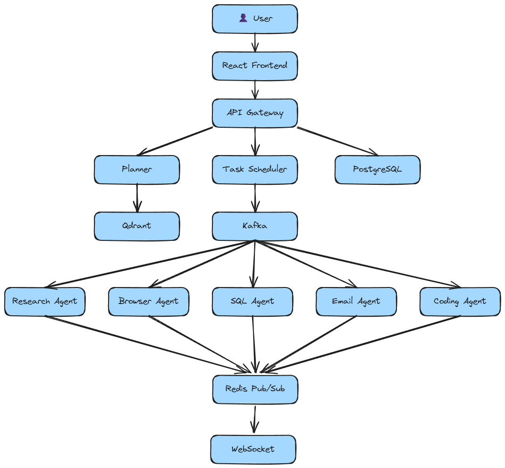

#  SecureAI - Distributed Multi-Agent AI Platform

> A production-ready distributed AI orchestration platform that coordinates multiple specialized AI agents to solve complex tasks through intelligent planning, task scheduling, and real-time collaboration.

---

## 📖 Overview

SecureAI enables multiple AI agents to collaborate on a single user request.

Instead of relying on one general-purpose model, SecureAI decomposes a complex task into smaller subtasks, assigns them to specialized agents, and streams results back to the user in real time.

---

##  System Architecture


<p align="center">
  
</p>

---

## ✨ Features

###  Multi-Agent Orchestration

- AI-powered task planning
- Capability-based agent routing
- Parallel and sequential workflow execution
- Dynamic agent discovery

###  Real-Time Communication

- WebSocket-based live updates
- Redis Pub/Sub event streaming
- Task progress monitoring

### 📦 Distributed Architecture

- Kafka message broker
- Independent microservices
- Asynchronous task execution
- Fault-isolated workers

###  Intelligent Planning

- LLM-powered Planner
- Automatic task decomposition
- Multi-step workflow generation
- Context-aware execution

### 💾 Persistent Memory

- PostgreSQL for structured data
- Redis for caching and messaging
- Qdrant vector database for semantic memory

---

# 🏛️ Architecture

```
                User
                  │
         React Frontend
                  │
            API Gateway
                  │
      ┌───────────┴───────────┐
      │                       │
   Planner                PostgreSQL
      │
 Task Scheduler
      │
     Kafka
      │
 ┌────┼────┬────┬────┬────┐
 │    │    │    │    │
Research Browser SQL Email Coding
 Agent   Agent Agent Agent Agent
      │
   Redis Pub/Sub
      │
  WebSocket Server
      │
 React Frontend

Planner
    │
Qdrant Vector Memory
```

---

# 🧩 Core Components

## API Gateway

- REST API entry point
- Authentication & authorization
- Request validation
- Service routing

---

## Planner

Responsible for:

- Understanding user intent
- Task decomposition
- Workflow generation
- Agent selection

---

## Scheduler

Responsible for:

- Publishing jobs to Kafka
- Queue management
- Retry policies
- Task prioritization

---

## AI Agents

Each agent performs one specialized responsibility.

| Agent | Responsibility |
|--------|----------------|
| 🔍 Research Agent | Deep research and summarization |
| 🌐 Browser Agent | Web scraping and information retrieval |
| 🗄 SQL Agent | Database queries |
| 📧 Email Agent | Email automation |
| 💻 Coding Agent | Code generation & debugging |

---

## Infrastructure

| Component | Purpose |
|------------|----------|
| Kafka | Message Broker |
| Redis | Pub/Sub + Cache |
| PostgreSQL | Persistent Storage |
| Qdrant | Vector Database |
| Docker | Containerization |

---

# 🛠️ Tech Stack

### Backend

- FastAPI
- Python
- SQLAlchemy
- Pydantic

### Frontend

- React
- TypeScript
- Vite

### Databases

- PostgreSQL
- Redis
- Qdrant

### Messaging

- Apache Kafka
- Redis Pub/Sub
- WebSockets

### DevOps

- Docker
- Docker Compose

### AI

- OpenAI GPT
- LangGraph
- MCP Integration

---

# 📂 Project Structure

```
secureai/
│
├── frontend/
├── api-gateway/
├── planner/
├── scheduler/
├── research-agent/
├── browser-agent/
├── sql-agent/
├── email-agent/
├── coding-agent/
├── websocket/
├── memory-manager/
├── qdrant/
├── docker-compose.yml
└── README.md
```

---

#  Quick Start

### Clone

```bash
git clone https://github.com/<username>/secureai.git
cd secureai
```

### Configure

```bash
cp .env.example .env
```

Add your API keys.

### Start

```bash
docker compose up --build
```

Frontend

```
http://localhost:3000
```

API

```
http://localhost:8000
```

---

# 🔄 Request Lifecycle

```
User

↓

React Frontend

↓

API Gateway

↓

Planner

↓

Scheduler

↓

Kafka

↓

Specialized Agent

↓

Redis Pub/Sub

↓

WebSocket

↓

Frontend

↓

User
```


# 🎯 Roadmap

- [x] Multi-agent orchestration
- [x] Kafka-based messaging
- [x] Redis Pub/Sub
- [x] PostgreSQL
- [x] Qdrant semantic memory
- [x] WebSocket streaming
- [ ] Kubernetes deployment
- [ ] Auto-scaling workers

---

# 📄 License

MIT License

---

## ⭐ Highlights

- Distributed microservice architecture
- Event-driven communication with Kafka
- Real-time task streaming
- Vector memory using Qdrant
- Intelligent LLM task planning
- Dockerized deployment
- Modular agent framework
